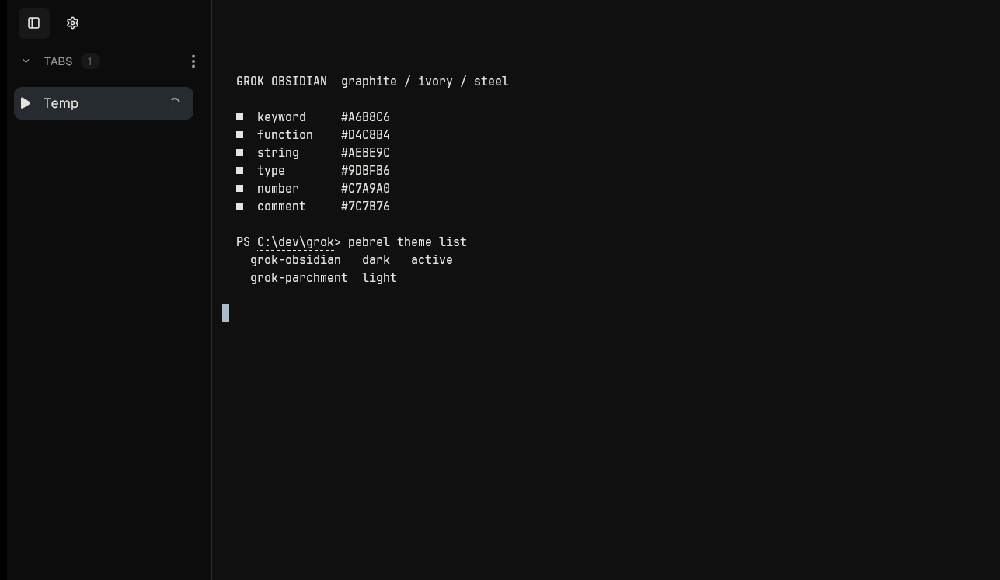
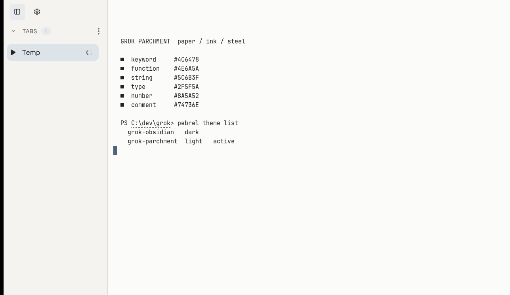

# Grok Themes for Pebrel

Two Pebrel themes built from the same graphite and ivory palette as the Zed and
Oh My Pi versions. Both are colors-only packages in Pebrel's native theme format.

- **Grok Obsidian** — dark. Chrome at `#0C0C0C`, terminal at `#101010`, with an
  extra-dark tabs pane.
- **Grok Parchment** — light. Neutral paper chrome with the same muted syntax
  palette.





## Installation

The themes are submitted to the Pebrel Community catalog
([PR #3](https://github.com/pebrel-community/themes/pull/3)). Once merged:

1. Open **Settings → Appearance → Community themes**.
2. Install **Grok Obsidian** or **Grok Parchment**.
3. Select the theme in the Appearance picker.

### Manual Install

Download the versioned ZIP from the
[latest release](https://github.com/MistanKh/pebrel-grok-theme/releases/latest),
then import it:

```sh
pebrel theme import grok-obsidian.pebrel-theme.zip
pebrel theme import grok-parchment.pebrel-theme.zip
```

Select the installed theme under **Settings → Appearance**.

## Palette

| Role | Obsidian | Parchment |
| --- | --- | --- |
| Chrome / sidebar | `#0C0C0C` | `#F4F3F0` |
| Tab cards | `#131313` | `#EFEEEB` |
| Terminal | `#101010` | `#FBFBF9` |
| Text / muted | `#E6E4DF` / `#9A9892` | `#242422` / `#686866` |
| Accent, cursor | `#A9BCCB` | `#4C6478` |
| Keyword | `#A6B8C6` | `#4C6478` |
| Function | `#D4C8B4` | `#4E6A5A` |
| String | `#AEBE9C` | `#5C6B3F` |
| Type | `#9DBFB6` | `#2F5F5A` |
| Number | `#C7A9A0` | `#8A5A52` |

The dark theme keeps the chrome darker than the terminal, matching the reference
Grok shell. `ui.background` controls the chrome; `ui.sidebar` controls tab-card
surfaces. Both variants are colors-only: no shaders, wallpapers, videos, or
external resources.

## Build

The repository contains the source theme documents and the portable packages are
built with Pebrel's own tooling:

```sh
pebrel theme pack \
  --output dist/grok-obsidian.pebrel-theme.zip \
  --author MistanKh \
  --license MIT \
  themes/grok-obsidian.pebrel-theme.json

pebrel theme check dist/grok-obsidian.pebrel-theme.zip
```

The community catalog expects a versioned tag with `.pebrel-theme.zip` assets;
the `v1.0.0` release contains both variants.

## Validation

- Both variants pass `pebrel theme check`.
- Tested with Pebrel 2.4.0 on Windows 11 (x64).
- Release archive sizes and SHA-256 values are pinned in the community catalog
  submission.

## Repository Layout

```text
themes/grok-obsidian.pebrel-theme.json
themes/grok-parchment.pebrel-theme.json
previews/grok-obsidian.png
previews/grok-parchment.png
README.md
LICENSE
```

## License

MIT. Independent and unofficial; not affiliated with xAI.
